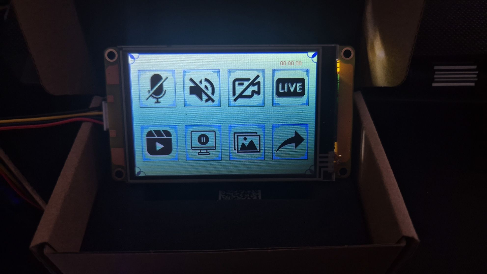

# NexDeck & NexStudio

**NexDeck**, Arduino Pro Micro tabanlı, dokunmatik ekranlı (Nextion 3.5"), 5 mekanik tuşlu, tekerlekli ve buzzer'lı açık kaynak bir makro kontrol panelidir — Stream Deck benzeri, yerli ve uygun maliyetli bir alternatif.
**NexStudio** ise NexDeck'i yöneten Windows uygulamasıdır: tuşlara görev atarsın, profiller arasında geçersin, telefondan kontrol edersin.



## Öne çıkanlar (2.5)

- **Stream Deck tarzı arayüz:** cihaz ekranda birebir çizili; görevleri tuşlara sürükleyip bırak.
- **Gerçek USB klavye modu:** NexDeck tuşları donanım klavyesi gibi basabilir; hile korumalı oyunlarda ve OBS'de güvenilir çalışır.
- **NexStudio Web:** aynı arayüz telefonda (aynı Wi-Fi, PIN korumalı). *Kontrol* modunda tuşa dokun, görev bilgisayarda çalışsın.
- **Profiller:** her profil kendi tuş atamalarını tutar; cihazdaki bir tuşla profil değiştir.
- **Kişiselleştirme:** tuşlara emoji ya da resim, açık/koyu tema, vurgu rengi, arka plan fotoğrafı, şeffaf paneller.
- **Canlı gösterim:** cihazdaki tuşa basınca ekranda yanıp söner, tekerleği çevirince ekrandaki tekerlek döner.
- **Eklentiler:** OBS, Spotify, Discord, Zoom, VS Code, Photoshop… ve kendi eklentini birkaç satırla yazabilirsin.
- **Kararlılık:** kopunca otomatik yeniden bağlanma, bozulmaya dayanıklı ayar dosyası, hata günlüğü.

## Sürüm geçmişi

| Sürüm | Tarih | Özet |
|---|---|---|
| [2.5](../../releases/tag/nexstudio-v2.5.0) | 27.11.2026 | Yeni arayüz, NexStudio Web, döndürülebilir tekerlek, canlı gösterim |
| [2.0](../../releases/tag/nexstudio-v2.0.0) | 25.11.2026 | Kararlılık sürümü, firmware 2.0 (USB HID), otomatik yeniden bağlanma |
| [1.5](../../releases/tag/nexstudio-v1.5.0) | 18.06.2026 | Web Kontrolü güvenliği, tanınan cihazlar, sistem günlüğü |
| 1.x | 2026 | İlk NexDeck masaüstü uygulaması |

Tüm ayrıntılar ve her değişikliğin nedeni: [CHANGELOG.md](CHANGELOG.md)

## Depo yapısı

```
src/
├── nexstudio_ui.py        Uygulama çekirdeği (PyQt5): seri port, görevler, web sunucusu, klasik görünüm
├── web_ui/app.html        Yeni arayüz (masaüstü penceresi + NexStudio Web)
├── plugins/               Hazır eklentiler (ilk açılışta %APPDATA%\NexStudio\plugins'e kopyalanır)
├── locales/               tr / en dil dosyaları
└── nircmd.exe, ikonlar
hardware/
├── NewArduino/            Pro Micro firmware (2.0) ve eski firmware yedeği
├── Nextion/               Ekran tasarımı (dsplay.HMI) ve derlenmiş dosya (dsplay.tft)
└── STDECK/                İlk prototip firmware (sadece HID)
installer/                 Inno Setup betiği
tests/                     Otomatik testler
docs/ui_prototype/         Yeni arayüzün ilk tıklanabilir taslağı
NexStudio.spec, build.bat  Exe derleme
```

## Kurulum (kullanıcılar)

[Releases](../../releases) sayfasından `NexStudio_Setup_x.y.z.exe` dosyasını indirip kurun. Windows 10/11 gerekir; yeni arayüz Windows'un WebView2 bileşenini kullanır (Windows 11'de hazır gelir, yoksa uygulama klasik görünümle açılır).

## Geliştirme

```powershell
pip install -r requirements.txt
python src\nexstudio_ui.py
```

Gerçek ayarlarına dokunmadan denemek için ayrı veri klasörü:

```powershell
$env:NEXSTUDIO_DATA_DIR = "$env:TEMP\nexstudio-test"; python src\nexstudio_ui.py
```

Exe ve kurulum: `build.bat` → `dist\NexStudio\NexStudio.exe`, sonra `installer\NexStudio_Setup.iss` dosyasını Inno Setup ile derleyin.

Testler: [tests/README.md](tests/README.md)

## Firmware

1. Arduino IDE'de **Encoder** (Paul Stoffregen) ve **HID-Project** (NicoHood) kütüphanelerini kurun.
2. Kart: *Arduino Leonardo* (Pro Micro 5V/16 MHz).
3. `hardware/NewArduino/NexDeckArduino.ino` dosyasını yükleyin.

NexStudio bağlanınca Sistem Günlüğü'nde `NexDeck tanındı · firmware 2.0 · özellikler: HID, PING` görünür. Seri protokol firmware dosyasının başında açıklanmıştır.

## Eklenti yazma

`%APPDATA%\NexStudio\plugins\` içine bir `.py` dosyası koyun:

```python
PLUGIN_NAME = "Örnek"
ACTIONS = {
    "Kaydet": {"type": "plugin", "plugin_name": PLUGIN_NAME, "function": "save"},
}

def execute(func):
    if func == "save":
        nex.send_hotkey("ctrl+s")   # güvenilir tuş gönderimi (SendInput / USB HID)
        nex.log("Kaydedildi")       # Sistem Günlüğü'ne yazar
```

`nex` nesnesini NexStudio ekler; ayarlar için `nex.get_setting("anahtar", varsayılan)`. Her eklenti kendi thread'inde çalışır.

## Nasıl geliştirildi

NexDeck'in fikri, donanım tasarımı, devresi, kasası ve testleri Ali Mert Taşcı'ya aittir. Yazılım tarafında (NexStudio ve firmware) **yapay zekâ destekli geliştirme araçlarından** yararlanıldı: ChatGPT ve Claude (Anthropic) kod yazımında, hata ayıklamada, arayüz tasarımında ve dokümantasyonda kullanıldı.

Yapay zekâ ile üretilen her değişiklik gerçek cihaz üzerinde denendi. Hangi sorunun neden çıktığı ve nasıl çözüldüğü [CHANGELOG.md](CHANGELOG.md) dosyasında açıkça yazıyor. Kodda gözünüze çarpan bir hata ya da daha iyi bir yöntem olursa Issue açmanız çok değerli.

## Katkı

Hata bildirimi ve öneriler için Issues açabilir, Pull Request gönderebilirsiniz. Büyük değişikliklerden önce bir Issue ile konuşalım.

## Lisans

NEXSTUDIO ÖZGÜR YAZILIM LİSANSI (NPL-v2) — ücretsiz kalmak ve asıl yapımcıya atıf yapmak şartıyla değiştirilebilir ve paylaşılabilir. Ayrıntılar: [LICENSE.txt](LICENSE.txt)

Telif Hakkı (c) 2026 — Ali Mert Taşcı / NexHub
